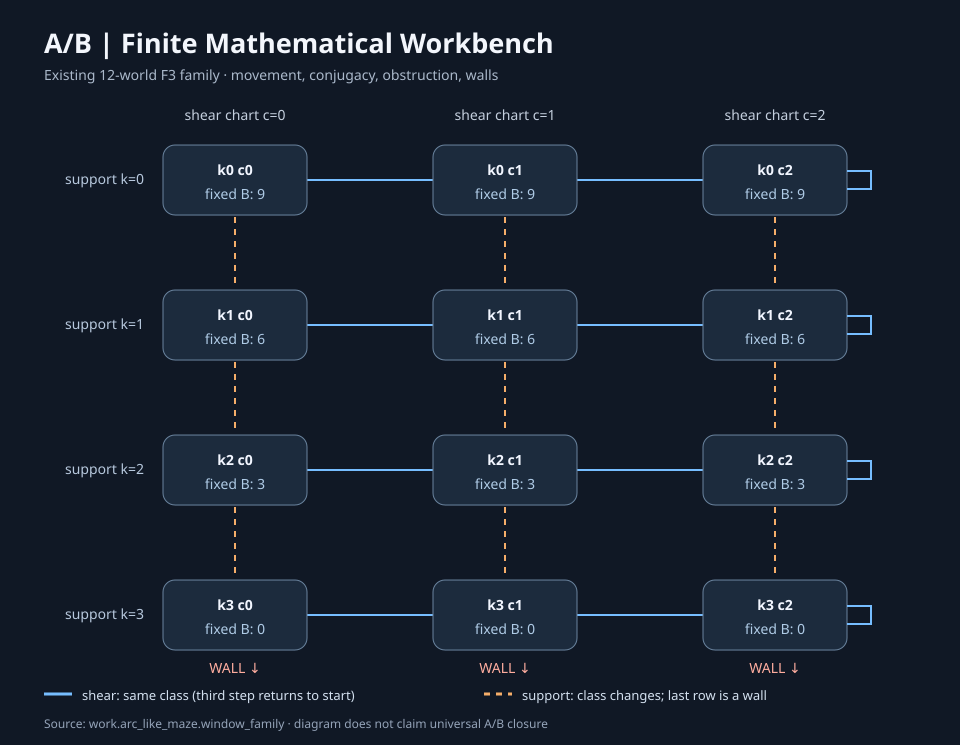

# A/B finite mathematics workbench — REA evidence boundary

This is a runnable, read-only view over the **existing** [12-world finite mathematical family](../../work/arc_like_maze/window_family.py), not a new definition of the [Language Referent](../../LANGUAGE_REFERENT.md).

The workbench has two separately owned sides:

- **Mathematics:** the workstation's declared 12 `ClassifiedWindow` objects and their exact `WindowProcess` transitions, conjugacy witnesses, fixed-`B` obstructions, constructor movements and terminal walls. The code calls the original implementations; it does not recreate their rules.
- **Reverse-engineering evidence:** [morluto/rea](https://github.com/morluto/rea) (MIT-licensed, no bundled REA code). REA inspects an authorized local JS/Electron app or other supported target and exports its own Evidence. This tool can index the saved canonical REA JSON by SHA-256 and original evidence ID. It does **not** silently convert an inferred code edge into a mathematical correspondence.

## View the actual finite family



The blue shear movement cycles across the three charts `c=0,1,2` for each fixed support `k`. The orange support move changes the invariant and reaches the declared support boundary at `k=3`. All labels refer to the stated finite family.

## Run the math

From the repository root:

```bash
python -m tools.ab_math_workbench survey --output /tmp/ab-survey.json --svg /tmp/ab-survey.svg
python -m tools.ab_math_workbench compare --left 1 0 --right 1 2
python -m tools.ab_math_workbench compare --left 1 0 --right 2 0
python -m tools.ab_math_workbench trace --world 2 1 --actions ABABBABA --depth 5
python -m unittest network.tests.test_ab_math_workbench -v
```

The survey enumerates 12 concrete laws, 21 constructor edges (12 shear + 9 support), three explicit support walls, 66 unordered comparisons and the original family certificate. It retains the original distinction between a full-state all-depth conjugacy witness and a depth-three fixed-`B` obstruction. The word trace checks each `WindowProcess.inverse` against its actual preceding state.

The output is deterministic JSON with a named mathematical owner; the SVG is a **projection** generated from the same finite-family parameters, not a second authority.

## Use REA as the observation input

REA's [official documentation](https://github.com/morluto/rea/blob/main/docs/cli.md) specifies the static JavaScript/Electron analysis command. After separately installing REA using its official source and verifying the local target is within your authorized scope:

```bash
rea analyze-javascript-application /absolute/path/to/your-app --json > /tmp/rea-evidence.json
python -m tools.ab_math_workbench rea-evidence /tmp/rea-evidence.json --output /tmp/rea-reference.json
```

Or run the same documented static scan and preserve both output files in one explicit command (output directories must exist; existing files are not overwritten):

```bash
python -m tools.rea_ab_bridge /absolute/path/to/your-app \\
  --evidence-output /tmp/rea-evidence.json \\
  --reference-output /tmp/rea-reference.json
```

The bridge invokes an **already installed** `rea` CLI on the specified JS/Electron directory or ASAR. It does not install software, run analysis automatically, or modify the application. The command is not tested against a real installed REA provider in this branch; regression tests use a simulated successful REA CLI process.

The second command keeps the original `evidence_id`, analysis profile, advertised coverage, limitations, unknowns and a digest of the **full** source bytes, while preserving the original REA Evidence file for detailed study. Ingestion is limited to 128 MiB for this first local tool; REA itself may emit a larger record. The math workbench only reads saved Evidence; the optional REA bridge calls the CLI for an explicitly selected target. Neither creates a verified mathematical relationship, updates workstation state, or authenticates a manually modified Evidence record.

REA has separate workflows for tracing features and comparing application versions. A mathematical claim about observed software requires *another explicit step*: select a specific edge and admissible source authority, define the proposed mathematical state/action relation, and verify a commuting map or produce a counterexample. Until that is implemented and witnessed, **the boundary is open**, rather than reported as completed.

## Evidence and current limits

- The mathematical result is scoped to the named finite construction family in `work/arc_like_maze/window_family.py`. It is not proof of a universal A/B equivalence or empirical physical law.
- REA static relationships may be inferred, candidate, unresolved, or incomplete. An empty edge list with incomplete coverage cannot establish absence, and REA does not prove semantic equivalence.
- The current evidence intake *references* REA observations; it does not automatically perform source-to-math mapping or run reverse engineering. REA itself remains independently maintained.
- No modification was made to the original finite math, the workstation journal, public profile, or the third-party REA repository.

## Sources

[Mathematical contract](../../work/arc_like_maze/README.md) · [Engine code](../../work/arc_like_maze/window_family.py) · [REA source](https://github.com/morluto/rea) · [REA cross-layer Evidence documentation](https://github.com/morluto/rea/blob/main/docs/javascript-application-workflows.md) · [Math code](../../tools/ab_math_workbench.py) · [REA bridge](../../tools/rea_ab_bridge.py) · [Tests](../../network/tests/test_ab_math_workbench.py)
