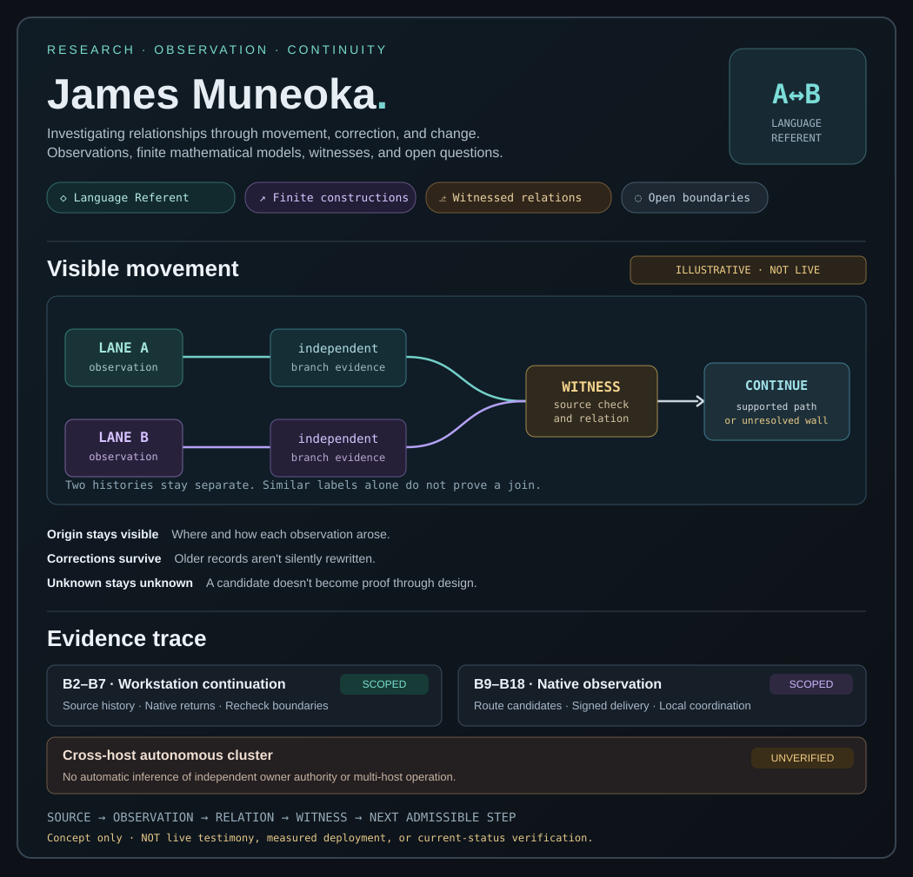

# Visual provenance — GitHub README concept

> **Current profile-wide A/B visual:** [James's public visual provenance map](https://github.com/huntingthereferent/huntingthereferent/blob/main/VISUAL_PROVENANCE.md). It carries the same continuing inquiry through writing, games, mathematics, interactive environments, the workstation and software while linking each context to its own evidence.
>
> The image below is the earlier static technical preview. The public profile map is the broader reader-facing entry, not a second evidence authority.

**Illustrative, not live.** This is a read-only presentation of how source-backed research provenance *could* appear in a GitHub profile. The diagram is a design example; it does not read live workstation data or assert current job results.

The view intentionally places the **relationships** before follower counts, code-language percentages, popularity statistics or synthetic green checkmarks. It shows that two distinct histories can approach a connection without being collapsed into a single story. Their connection needs an actual independently checked witness, and unknown or contradicted relationships remain visible.

## Follow the source, not the image

| Area | Source | What the illustration does **not** establish |
| --- | --- | --- |
| Language and observation | [James's first-person record](https://github.com/huntingthereferent/huntingthereferent/blob/main/writing/LANGUAGE_AND_OBSERVATION.md) | A universal definition of A/B mathematics |
| A/B finite mathematics | [Declared constructions](../../work/arc_like_maze/README.md) | General equivalence outside the declared mathematical family |
| Workstation continuation | [B2 witness-gated lanes](../../systems/workspace/WORKSTATION_CONTINUATION_B2.md) · [B4 verified next movement](../../systems/workspace/WORKSTATION_RETURN_CONTINUATION_B4.md) | A live unconstrained model-worker cluster |
| Observational determination | [Continuous Handoff](../../language/handoff/CONTINUOUS_HANDOFF.md) · [B9 candidate construction](../../systems/workspace/WORKSTATION_CONSTRUCTION_B9.md) | Every possible route being observed or proven |
| Local native coordination | [B18 scope and limits](../../systems/workspace/B18_COORDINATED_OBSERVED_NATIVE.md) | Cross-host distributed guarantees |

## How to use the preview

- **Inside GitHub:** this README displays the SVG directly, with its source and caveats alongside it.
- **Read-only layer:** neither the diagram nor this README changes `RuntimeJournal`, workstation lanes, native witness conditions or project state.
- **Later live generation:** an evidence-owner-backed renderer could replace the illustrative values *only after* it reads authentic source records and preserves uncertainty, provenance and versioned witness boundaries.

This rendering lives in `views/`, the existing [read-only presentation layer](../README.md). It is intentionally **not** in `evidence/`, `runtime/`, or the profile's authoritative research writing.

**Status:** design preview only; not deployed, not a live data feed, and not a replacement for James's existing profile README.
