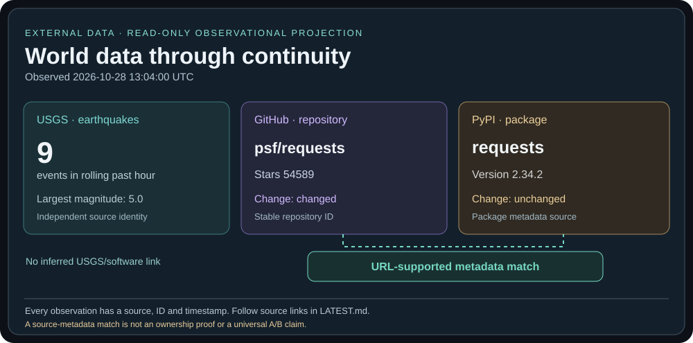

# Latest world observation

Collected: 2026-10-20T01:02:47.604205+00:00 (UTC). This projection uses the original public-data-monitor adapters.

| Source | State | Direct source |
| --- | --- | --- |
| USGS / rolling past hour | 9 events | [USGS](https://earthquake.usgs.gov/earthquakes/feed/v1.0/summary/all_hour.geojson) |
| GitHub / psf/requests | changed | [GitHub](https://github.com/psf/requests) |
| PyPI / requests | unchanged | [PyPI](https://pypi.org/project/requests/) |

## Relationship: GitHub and PyPI

Result: **matched by local metadata rule**, not independently verified ownership.

- explicit_project_url: github.com/psf/requests (rule weight 100)
- normalized_name: requests (rule weight 20)

USGS is **not connected** to the software observations merely because their timestamps overlap. Because its feed is a sliding window, absence from the next fetch is not evidence of disappearance.

## Verify the observation

- [Machine-readable observations and source IDs](latest.json)
- [Historical poll summaries](checks.jsonl)
- [Actual public-data-monitor adapters](../../work/projects/public-data-monitor/app/)
- [Original change and identity logic](../../work/projects/public-data-monitor/app/platform.py)
- [Original identity rule](../../work/projects/public-data-monitor/app/identity.py)
- [Existing Prometheus instrumentation](../../work/projects/public-data-monitor/app/metrics.py)

The SHA-256 digest in latest.json is an integrity fingerprint, **not** proof of source authenticity. The SVG is GitHub-rendered output, not a running Prometheus database or proof of continuous hosting.
